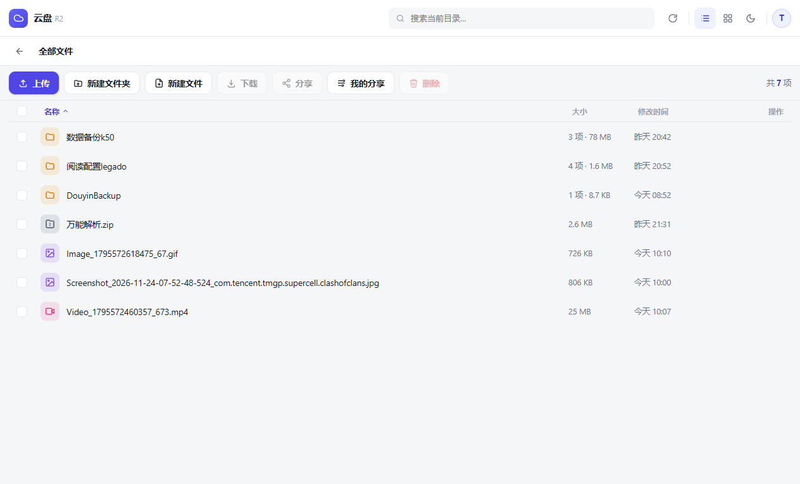
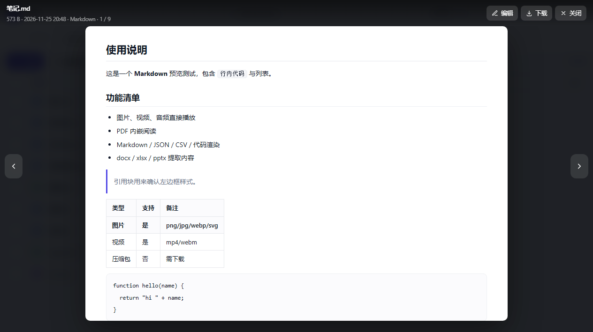
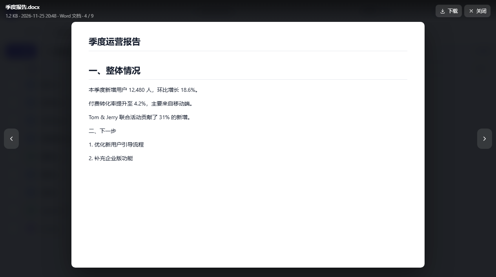
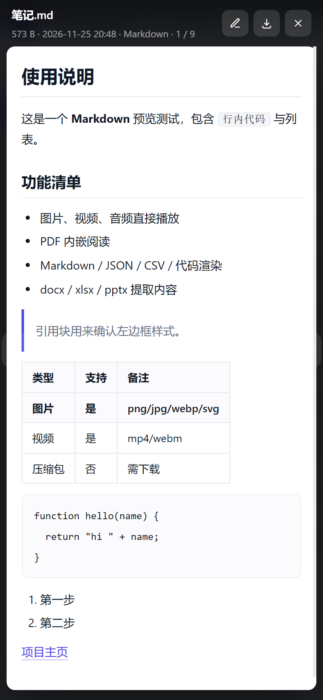
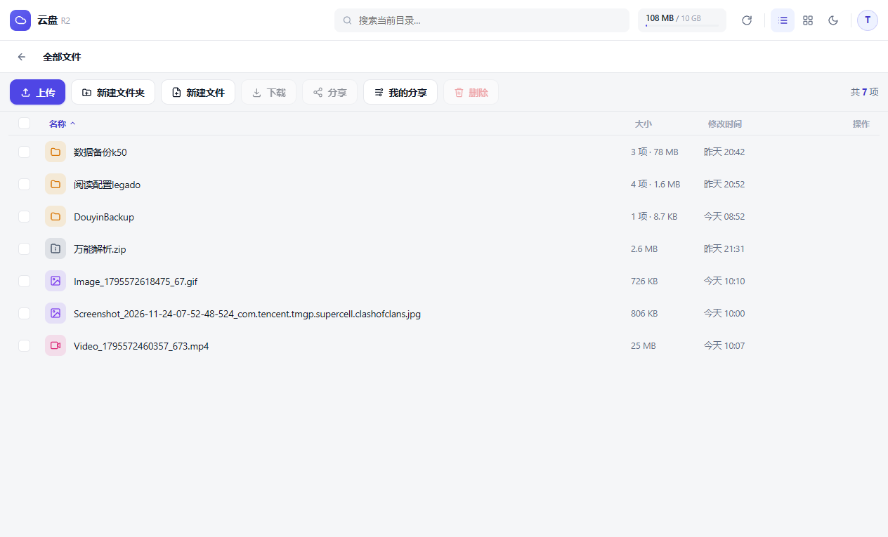
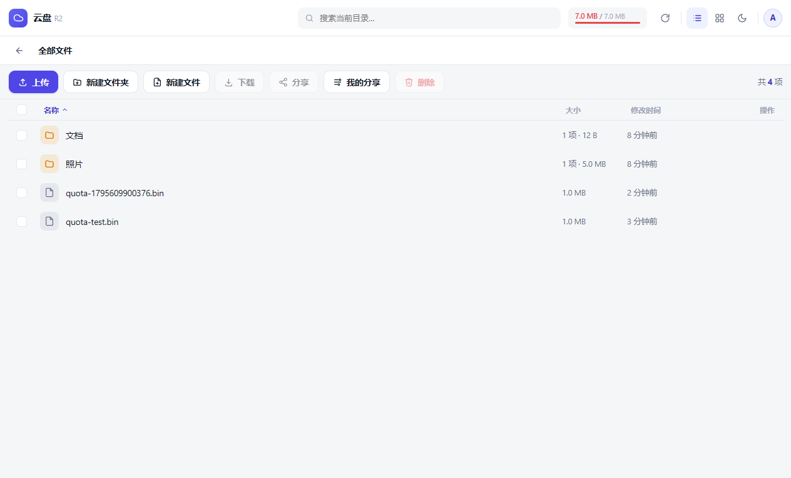
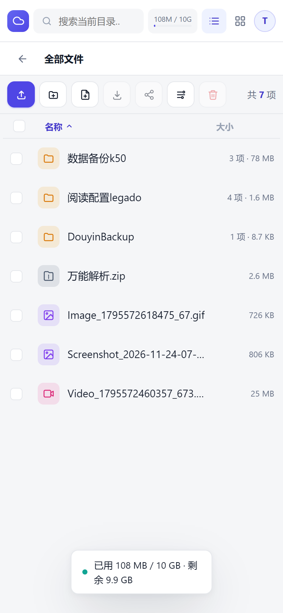

# R2 WebDAV

作者：**流水**

把 Cloudflare R2 变成一个能挂载、能网页管理、能对外分享的网盘。

它是一段跑在 Cloudflare Workers 上的程序，把一个 R2 存储桶包装成标准 WebDAV 服务，同时自带一个浏览器文件管理页面。挂到 Windows 资源管理器、macOS Finder、手机文件管理器里就是一个网盘；用浏览器打开就是一套网盘界面。



---

## 功能

### WebDAV

- 支持 **Class 1** 与 **Class 2**，带 `LOCK` / `UNLOCK`，Office、Photoshop 这类需要加锁的软件能正常写入
- 完整方法：`OPTIONS` `PROPFIND` `PROPPATCH` `MKCOL` `PUT` `GET` `HEAD` `DELETE` `COPY` `MOVE` `LOCK` `UNLOCK`
- 支持 Range 断点续传、条件请求（`If-Match` / `If-None-Match` / `If-Modified-Since`）
- 中文、空格、特殊字符文件名正常
- 目录可以无限层级，空目录也能保存

### 网页文件管理器

- **上传**：点按钮或多选，也能把文件直接拖进页面；多文件并发上传，每个文件显示进度条、百分比、已传/总大小与实时速度
- **下载**：单文件直接下载，多选批量下载
- **新建**：新建文件夹、新建文本文件并当场编辑
- **管理**：重命名、删除（文件夹递归删除，有二次确认）、移动
- **预览**：点一下就打开预览，不用先下载。图片、视频、音频、PDF、网页、Markdown、JSON、CSV、代码、纯文本都能看；Word / Excel / PPT（docx / xlsx / pptx）直接提取文字和表格显示；预览里可以左右切换同目录的其它文件
- **浏览**：列表 / 网格两种视图，面包屑导航，按名称/大小/时间排序，当前目录内搜索
- **文件夹信息**：每个文件夹直接显示「N 项 · 总大小」，鼠标悬停看递归明细
- **容量**：右上角常驻显示「已用 / 总量」，默认总额度 10 GB，实际最多可写 9.9 GB；超过 85% 变黄、写满变红
- **快捷键**：单击打开、右键菜单、`Delete` 删除、`F2` 重命名、`Ctrl+A` 全选、`Ctrl+S` 保存；预览里 `←` `→` 切换文件、`Esc` 关闭
- **手机**：响应式布局，长按弹出操作菜单
- **主题**：浅色 / 深色，跟随系统也可手动切换

### 外链分享

- 选中文件或文件夹生成分享链接，对方无需登录即可下载
- 可设置**提取码**（不需要 / 自动生成 / 自定义）
- 可设置**有效期**：1 小时 / 1 天 / 7 天 / 30 天 / 永久，或自定义「数值 + 分钟 / 小时 / 天 / 月 / 年」，最长 10 年
- 可限制**下载次数**：填一个数字即上限，留空表示不限；每次真正下载计 1 次，在线预览与 `HEAD` 不计数，用完后链接立即返回「下载次数已用完」
- 记录**下载次数**，列表里直接显示「已下载 / 上限」，用尽的分享带「次数用完」标记
- 「我的分享」面板集中管理所有链接：搜索、复制、打开、单条删除、批量删除、全部清空

---

## 使用方法

### 一、部署

需要：Cloudflare 账号、Node.js 18 以上、已开通 R2（免费额度 10 GB 存储，需在后台绑定支付方式）。

```bash
git clone https://github.com/<你的用户名>/r2-webdav.git
cd r2-webdav
npm install

npx wrangler login
npx wrangler r2 bucket create weddav      # 桶名可自定

cp wrangler.toml.example wrangler.toml
# 打开 wrangler.toml，把 bucket_name 改成上面创建的桶名

npx wrangler deploy
```

部署成功后会输出一个 `https://r2-webdav.<你的子域>.workers.dev` 地址，浏览器打开即可。

> 国内网络访问 `*.workers.dev` 常被阻断。绑一个自己的域名即可解决：在 `wrangler.toml` 里取消 `[[routes]]` 段的注释，把 `pattern` 换成你的域名（该域名需托管在同一个 Cloudflare 账号下），再 `npx wrangler deploy`。

### 二、登录

**默认账号和密码都是 `admin`。**

打开部署好的地址，输入 `admin` / `admin` 即可进入。

不想用默认密码，部署后改一次：

```bash
npx wrangler secret put WEBDAV_PASS      # 输入新密码
```

用户名改 `wrangler.toml` 里的 `WEBDAV_USER`，改完重新 `npx wrangler deploy`。

> 注意：同一个名字不能既写在 `wrangler.toml` 的 `[vars]` 里又用 `wrangler secret put` 设置，否则部署会报 `code: 10053`。用户名放 `[vars]`，密码只用 secret。

登录页有「在这台设备上记住登录」，勾选后凭据存在浏览器本地，下次打开直接进文件列表。

### 三、网页管理文件

登录后就是「全部文件」页面。

| 想做什么 | 怎么做 |
| --- | --- |
| 上传文件 | 点「上传」选文件，或把文件拖到页面任意位置 |
| 新建文件夹 | 点「新建文件夹」，输入名字 |
| 新建文本 | 点「新建文件」，输入文件名，直接在弹窗里写内容 |
| 打开 / 预览 | 单击文件即预览；文件夹则进入下一层 |
| 重命名 | 右键 →「重命名」，或选中后按 `F2` |
| 删除 | 选中后点「删除」，或按 `Delete` |
| 下载 | 行尾下载图标；多选后点顶部「下载」 |
| 搜索 | 右上角搜索框，只在当前目录内匹配 |
| 换视图 | 右上角列表 / 网格图标切换 |
| 换主题 | 右上角太阳 / 月亮图标，或在手机上跟随系统 |
| 看容量 | 右上角「已用 / 总量」，点一下弹出剩余空间；悬停看文件数、目录数与写入上限 |

手机上长按文件行会弹出操作菜单，功能与右键菜单一致。

**能预览哪些文件**

| 类型 | 格式 | 预览效果 |
| --- | --- | --- |
| 图片 | png jpg jpeg gif webp bmp svg ico avif | 原图显示，点一下放大到 1:1，再点还原 |
| 视频 | mp4 webm mov m4v mkv ogv | 内嵌播放器，边下边播，可拖动进度条 |
| 音频 | mp3 wav flac aac m4a ogg opus | 内嵌播放器，带封面 |
| 文档 | pdf | 内嵌 PDF 阅读器 |
| 网页 | html htm | 在沙箱里渲染，脚本可运行但拿不到本站数据 |
| 文本 | md json csv tsv txt log ini conf yml yaml env | Markdown 渲染成排版、JSON 自动缩进、CSV 变表格、纯文本保留换行 |
| 代码 | js ts py go rs java c cpp css xml sh sql 等 | 带行号的代码视图 |
| Office | docx xlsx pptx | 直接解析出正文、标题、表格与每页文字（不需要 Office） |
| 其它 | zip rar 7z doc xls ppt 等 | 提示下载，不浪费流量 |

预览窗口里可以用左右箭头或 `←` `→` 切换同目录下的其它文件，手机上左右滑动即可。超过 6 MB 的文本、超过 24 MB 的 Office 文件不会在线解析，会直接给下载入口。

> 单击是打开。要多选就走行首方框，或按住 `Ctrl` / `Cmd` / `Shift` 再点。







### 四、用 WebDAV 客户端连接

| 项目 | 值 |
| --- | --- |
| 地址 | `https://你的域名/` |
| 用户名 | `admin`（或你设置的用户名） |
| 密码 | `admin`（或你设置的密码） |

**Windows 资源管理器**：此电脑 → 右键「映射网络驱动器」→ 输入 `https://你的域名/` → 输入账号密码。
若提示不安全连接，先改注册表允许 Basic 认证明文传输：

```
HKEY_LOCAL_MACHINE\SYSTEM\CurrentControlSet\Services\WebClient\Parameters
BasicAuthLevel = 2 (DWORD)
```

改完重启 `WebClient` 服务。

**macOS Finder**：访达 → 前往 → 连接服务器（`⌘K`）→ 输入 `https://你的域名/` → 选择「注册用户」→ 输入账号密码。

**Android**：用「ES 文件浏览器」「Solid Explorer」或「RCX」，新建 WebDAV 连接，填地址与账号密码。

**iOS**：用「Documents」「FE File Explorer」，新建 WebDAV 连接。

**rclone**：

```bash
rclone config
# 选择 new remote，类型搜 webdav
# url 填 https://你的域名/
# vendor 选 other
# user / pass 填账号密码
```

### 五、分享文件

1. 勾选一个文件或文件夹
2. 点顶部「分享」
3. 需要的话填提取码；有效期选内置档位，或选「自定义」自己填数值和单位（分钟 / 小时 / 天 / 月 / 年）
4. 想让链接只够用几次，就在「下载次数」里填个数字；留空表示不限
5. 点「创建分享」，复制链接发给对方

对方打开链接后：有提取码就输入提取码，然后可以在线预览或下载。文件夹分享会列出目录内容，可逐个下载。设了下载次数的分享，页面顶部会显示「已下载 1 / 5 次」，次数用完后再打开或再下载都会收到「下载次数已用完」。

管理已创建的分享：顶部「我的分享」→ 可以搜索、复制链接、打开验证、单条删除或批量删除，每行都标着已下载次数与上限。

### 六、容量显示

右上角常驻一个小条：左边是已用大小，右边是总额度。



- 额度**默认 10 GB**，实际能写到 **9.9 GB**（留 1% 余量，进度条不会顶到 100% 才失败）
- 点一下弹出「已用 / 剩余」，鼠标悬停能看到文件数、目录数和写入上限
- 用到 85% 进度条变黄，写满变红
- 上传前会先算一遍，放不下就直接提示「空间不足」，不会传到一半才断
- 空间确实满了时，服务端返回 `507 Insufficient Storage`，WebDAV 客户端也能正确识别



手机上自动压成短格式，不占地方：



如果用的是 R2 免费额度（10 GB），建议保持默认值。想按自己需要分配，改 `QUOTA_TOTAL_GB` 即可，比如：

```toml
[vars]
QUOTA_TOTAL_GB = "5"      # 5 GB 额度，实际可写 4.95 GB
QUOTA_USABLE_PCT = "0.98" # 也可以自己调可用比例
```

---

## 配置项

在 `wrangler.toml` 的 `[vars]` 中设置：

| 变量 | 默认值 | 说明 |
| --- | --- | --- |
| `WEBDAV_USER` | `admin` | 登录用户名 |
| `WEBDAV_PASS` | `admin` | 登录密码，**建议用 `wrangler secret put WEBDAV_PASS` 设置** |
| `LOCK_TIMEOUT` | `3600` | 文件锁默认超时（秒），客户端可用 `Timeout` 头协商 |
| `READ_ONLY` | `0` | 设为 `1` 则整个网盘只读，禁止上传、修改、删除 |
| `QUOTA_TOTAL_GB` | `10` | 总额度（GB），只影响界面显示与写入上限 |
| `QUOTA_USABLE_PCT` | `0.99` | 可用比例，默认 0.99 —— 即 10 GB 的额度最多写到 9.9 GB |

---

## 常见问题

**打不开 `*.workers.dev` 地址**
国内网络对该域名有阻断，绑自己的域名即可。绑定时注意域名要托管在同一个 Cloudflare 账号里。

**上传大文件失败**
Cloudflare Workers 对单次请求体有大小限制（免费版 100 MB，付费版 500 MB）。超过限制的文件建议用 WebDAV 客户端分块上传，或直接传到 R2 后台。

**Windows 提示「无法访问」或「找不到网络路径」**
按上面「Windows 资源管理器」一节改 `BasicAuthLevel` 并重启 `WebClient` 服务。

**提示「空间不足」/ 507**
默认额度 10 GB、写入上限 9.9 GB。删掉一些文件，或把 `QUOTA_TOTAL_GB` 调大再重新部署。注意这个数字是自己设的上限，和 R2 套餐的容量是两回事：R2 那边还有空间，这里照样会拦。

**忘记密码**
重新执行 `npx wrangler secret put WEBDAV_PASS` 设一个新密码即可，不需要重新部署。

---

## 许可证

MIT License，作者：流水
